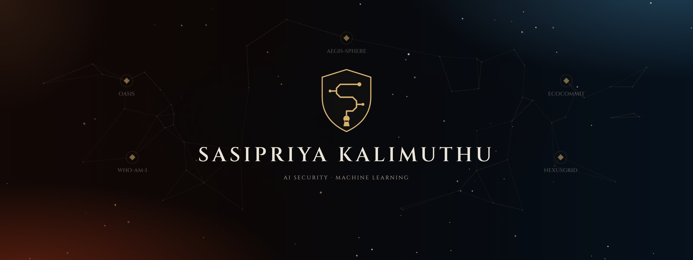

  &nbsp;
  &nbsp;
  

M.Sc. AI & Cybersecurity student at **CHRIST University, Bengaluru**, with a foundation in data science. I build security for AI systems: runtime guardrails for LLM agents, defences that tell a real fault from forged sensor data, and payment safety for AI agents.

**Open to AI security and machine learning roles.** Full write-ups, demos and the story behind each project are on my [portfolio](https://sasipriya-kalimuthu.vercel.app).

 

### [NexusGrid](https://github.com/AbineshSenthil/NexusGrid-CyberPhysEnv) · AI defence for a power grid under cyberattack

**Top 100 of 31,000+ teams** · OpenEnv Hackathon (Meta, PyTorch, Hugging Face) · Apr 2026 · Team project

An OpenEnv benchmark where an AI agent defends a 20-node power grid against physical faults and SCADA cyberattacks. It must tell real failures from forged sensor data across six tasks, from duck-curve dispatch to a full black start, with real power-flow physics and fully reproducible scoring.

`Python` `NumPy` `FastAPI` `Pydantic` `OpenEnv` `Gradio` `Docker` `Hugging Face` `pytest` &nbsp; [Live demo](https://huggingface.co/spaces/Abineshsdata/Nexus-Grid) · [Code](https://github.com/AbineshSenthil/NexusGrid-CyberPhysEnv)

### [Oasis](https://github.com/sasipriya1221/oasis) · Runtime security gateway for AI agents

Splunk Agentic Ops Hackathon · Jun 2026 · Solo

A runtime security gateway that checks every action an AI agent proposes before it runs, using three defences: prompt-injection detection, live CVE verification against NIST NVD, and a zero-trust permission allowlist. Every verdict is tagged with MITRE ATT&CK, logged to Splunk and exposed as MCP tools.

`Python` `FastAPI` `Pydantic` `MCP` `Splunk` `NIST NVD` `MITRE ATT&CK` &nbsp; [Live demo](https://sasipriya-kalimuthu.vercel.app/oasis-live.html) · [Code](https://github.com/sasipriya1221/oasis) · [Video](https://www.youtube.com/watch?v=Uxj9yjmq3pc)

### [Aegis-Sphere](https://github.com/AbineshSenthil/Aegis-Sphere) · Offline oncology decision support on one 8 GB GPU

MedGemma Impact Challenge (Kaggle) · Feb 2026 · Team project

Offline oncology decision support for clinics with no specialist and unreliable internet. It listens to a consultation, spots malignancy signals and convenes a virtual tumor board of eight medical models, including MedGemma and TxGemma, then checks drug interactions and stock, all on a single 8 GB GPU.

`PyTorch` `Hugging Face` `MedGemma` `FAISS` `Streamlit` &nbsp; [Live demo](https://aegis-sphere.streamlit.app/) · [Code](https://github.com/AbineshSenthil/Aegis-Sphere)

### [ECOCOMMIT](https://github.com/sasipriya1221/sasipriya1221-ECOCOMMIT) · Payment safety for AI agents

Razorpay AI Buildathon · Sep 2026 · Team project

Payment safety for AI agents. An instruction becomes a typed, inspectable contract, and deterministic code, not the model, decides whether money moves: missing, unclear or stale authority fails closed, with Razorpay Test Mode payments and a full audit trail.

`Python` `Pydantic` `LLM APIs` `SQLite` `pytest` `Razorpay Test Mode` &nbsp; [Video demo](https://www.youtube.com/watch?v=WjkrzrcffXk) · [Code](https://github.com/sasipriya1221/sasipriya1221-ECOCOMMIT)

### [WHO-AM-I](https://github.com/sasipriya1221/WHO-AM-I) · Privacy-first self-reflection with AI

CS Girlies Annual Hackathon · Aug 2026 · Solo, 48 hours

A self-reflection app where the AI suggests and the person decides. Game answers are never used to profile anyone, every AI guess shows its evidence and can be challenged, renamed or deleted, and deleting a reflection removes the inferences built on it.

`FastAPI` `Pydantic` `LLM APIs` `Docker` `GitHub Actions` `pytest` &nbsp; [Live demo](https://who-am-i-1z33.onrender.com) · [Code](https://github.com/sasipriya1221/WHO-AM-I) · [Video](https://www.youtube.com/watch?v=yhmUB3G9SNA)

**Earlier work**

- **Threat Intelligence Dashboard** · Mar 2025 · B.Sc. project: A threat intelligence dashboard that pulls exposed services, hosts and threat indicators from Shodan, Censys and live threat feeds through automated Python pipelines. Interactive Power BI and Tableau views bring them into one picture for early detection and response.
- **Product Data Scraper** · Aug 2023 · B.Sc. project: A Python and BeautifulSoup pipeline that automatically extracts product details from e-commerce websites. It turns scattered pages into structured data for consumer recommendation systems and competitive intelligence.

 

| | |
|---|---|
| **Build** | Python · FastAPI · Pydantic · BeautifulSoup |
| **AI & ML** | PyTorch · Hugging Face · LLM APIs · MCP · FAISS |
| **Security** | OWASP LLM Top 10 · MITRE ATT&CK · Splunk · Shodan & Censys · Linux |
| **Data & DevOps** | Docker · GitHub Actions · pytest · SQL & SQLite · Power BI & Tableau |

 

- **Top 100 of 31,000+ teams**, OpenEnv Hackathon by Meta, PyTorch and Hugging Face with Scaler. Reached the Bengaluru finale with NexusGrid (Apr 2026).
- **School topper, Rank 1**, Class XII (HSC), 90% (2022).

| Host | Hackathon | Project | Date |
|---|---|---|---|
| Meta | OpenEnv Hackathon · Top 100 | NexusGrid | Apr 2026 |
| Splunk | Agentic Ops Hackathon | Oasis | Jun 2026 |
| Kaggle | MedGemma Impact Challenge | Aegis-Sphere | Feb 2026 |
| Razorpay | AI Buildathon | ECOCOMMIT | Sep 2026 |
| CS Girlies | Annual Hackathon | WHO-AM-I | Aug 2026 |

 

| Role | Organisation | When | Work |
|---|---|---|---|
| **Founding Department Secretary** | B.Sc. Data Science, Kumaraguru College | 2024 – 25 | Led department-wide initiatives and ran technical symposiums and workshops with faculty for 200+ students |
| **Level 1 Member** | iQube Innovation Center | 2024 – 25 | Built a proof of concept for automated threat detection |
| **Data Analytics Intern** | Mallow Technology, Karur | Jun 2024 | Built end-to-end data pipelines and interactive Power BI dashboards |
| **Project Intern** | TATA Groups, Coimbatore | Feb – May 2023 | Data analysis with SQL, Python and Excel for business intelligence |

 

| Degree | Institution | Years |
|---|---|---|
| **M.Sc. Artificial Intelligence & Cybersecurity** | CHRIST (Deemed to be University), Bengaluru | 2025 – 27 |
| **B.Sc. Data Science** · 80% | Kumaraguru College of Liberal Arts & Science, Coimbatore | 2022 – 25 |
| **Class XII (HSC)** · 90% · School topper | Rasakondalar Matric. Hr. Sec. School, Coimbatore | 2022 |

 

<b>11 certifications</b>: Red Hat, OWASP (Infosys), Oracle Cloud, IIT (BHU), IBM, Coursera and more

 

| Certification | Issued by |
|---|---|
| Red Hat System Administration I & II | Red Hat · Feb 2026 |
| OWASP Top 10: Web Application Security | Infosys · Feb 2026 |
| Next-Generation Agritech: AI & Predictive Analytics | IIT (BHU) & CHRIST · Mar 2026 |
| Oracle Cloud Infrastructure Architecture | Oracle · Nov 2025 |
| Python Programming for Everybody | IBM |
| Exploratory Data Analysis with Python & Pandas | Coursera |
| Processing Data with Python | Coursera |
| Database Management Essentials | Coursera |
| Digital Transformation & Business Intelligence | STAIR |
| Robotic Process Automation Foundation (Naan Mudhalvan) | UiPath |
| Data Analytics with Excel | 360DigiTMG |

 

sasi.priya.1221@gmail.com · <a href="https://www.linkedin.com/in/sasi-priya">LinkedIn</a> · <a href="https://sasipriya-kalimuthu.vercel.app">Portfolio</a>

