<!-- The teaser. The full trailer is the portfolio. Every frame below is drawn in code (see /assets). -->

<a href="https://sasipriya-kalimuthu.vercel.app"></a>

  &nbsp;
  &nbsp;
  

> **Logline.** A data scientist crosses into AI security. Across seven battles she faces poisoned alerts, forged sensor readings and misread payments, and builds the defences that check every move before it lands.
>
> *Now studying M.Sc. AI & Cybersecurity at CHRIST, Bengaluru. Ready for my next quest in AI security and machine learning security, and eager to ride with curious, like-minded allies.*

 

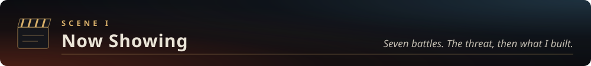

<a href="https://github.com/AbineshSenthil/NexusGrid-CyberPhysEnv">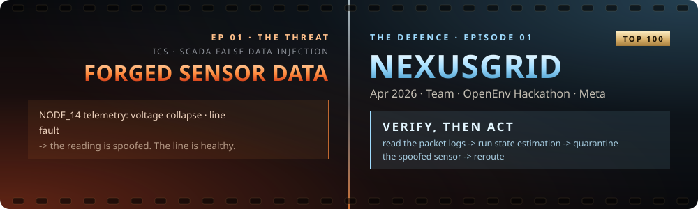</a>

<b>▶ <a href="https://huggingface.co/spaces/Abineshsdata/Nexus-Grid">Watch the scene</a></b> &nbsp;·&nbsp; <a href="https://github.com/AbineshSenthil/NexusGrid-CyberPhysEnv">Read the script</a> &nbsp;·&nbsp; Team project with Abinesh S

<a href="https://github.com/sasipriya1221/oasis">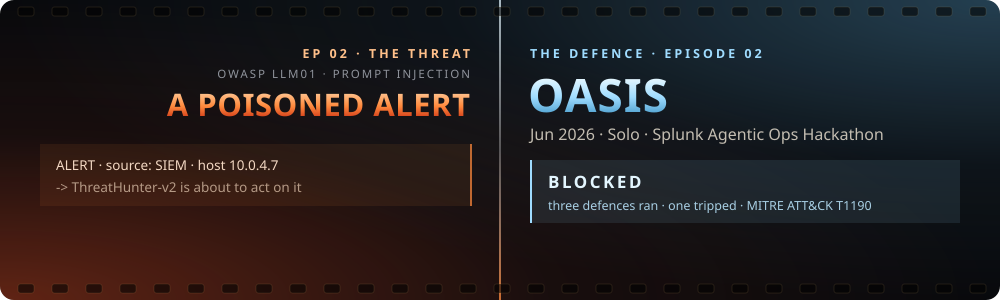</a>

<b>▶ <a href="https://sasipriya-kalimuthu.vercel.app/oasis-live.html">Watch the scene</a></b> &nbsp;·&nbsp; <a href="https://github.com/sasipriya1221/oasis">Read the script</a> &nbsp;·&nbsp; <a href="https://www.youtube.com/watch?v=Uxj9yjmq3pc">Video</a> &nbsp;·&nbsp; Solo

<a href="https://github.com/AbineshSenthil/Aegis-Sphere">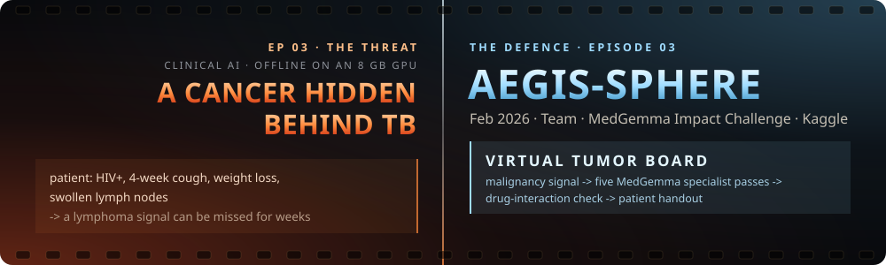</a>

<b>▶ <a href="https://aegis-sphere.streamlit.app/">Watch the scene</a></b> &nbsp;·&nbsp; <a href="https://github.com/AbineshSenthil/Aegis-Sphere">Read the script</a> &nbsp;·&nbsp; Team project with Abinesh S

<a href="https://github.com/sasipriya1221/ECOCOMMIT">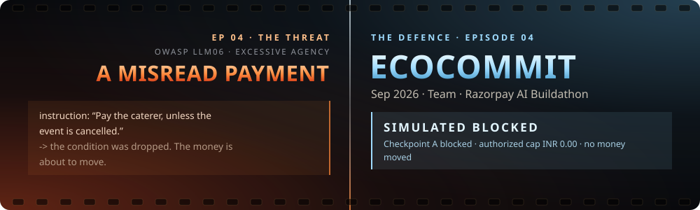</a>

<b>▶ <a href="https://www.youtube.com/watch?v=WjkrzrcffXk">Watch the scene</a></b> &nbsp;·&nbsp; <a href="https://github.com/sasipriya1221/ECOCOMMIT">Read the script</a> &nbsp;·&nbsp; Team

<a href="https://github.com/sasipriya1221/WHO-AM-I">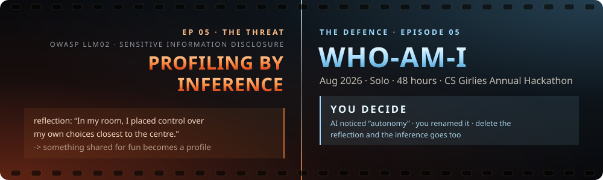</a>

<b>▶ <a href="https://who-am-i-1z33.onrender.com">Watch the scene</a></b> &nbsp;·&nbsp; <a href="https://github.com/sasipriya1221/WHO-AM-I">Read the script</a> &nbsp;·&nbsp; <a href="https://www.youtube.com/watch?v=yhmUB3G9SNA">Video</a> &nbsp;·&nbsp; Solo · 48 hours

<a href="https://sasipriya-kalimuthu.vercel.app/#projects">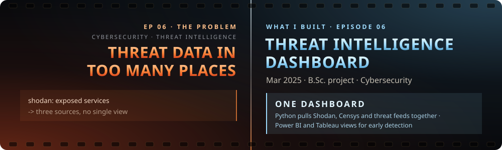</a>

<b>▶ <a href="https://sasipriya-kalimuthu.vercel.app/#projects">Shown in the trailer</a></b> &nbsp;·&nbsp; B.Sc. project · Mar 2025

<a href="https://sasipriya-kalimuthu.vercel.app/#projects">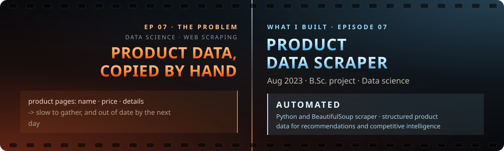</a>

<b>▶ <a href="https://sasipriya-kalimuthu.vercel.app/#projects">Shown in the trailer</a></b> &nbsp;·&nbsp; B.Sc. project · Aug 2023

 

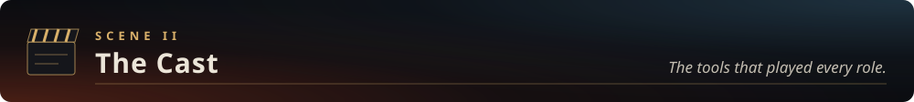

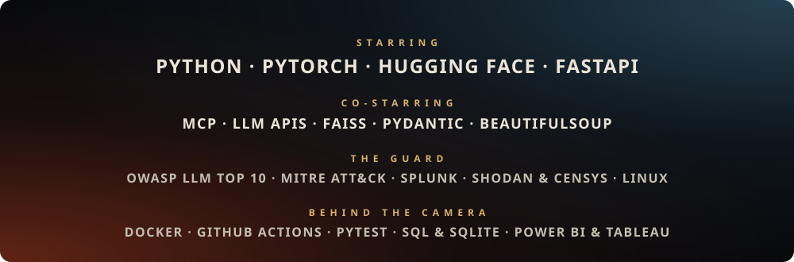

 

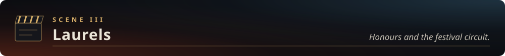

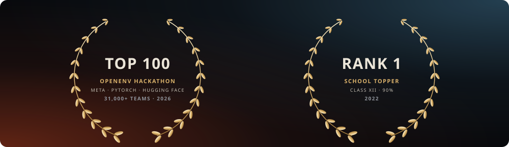

**The festival circuit**

| Host | Festival | Entry | Screened |
|---|---|---|---|
| **Meta** | OpenEnv Hackathon · **Top 100 of 31,000+ teams**, Bengaluru finale | NexusGrid | Apr 2026 |
| **Splunk** | Agentic Ops Hackathon | Oasis | Jun 2026 |
| **Kaggle** | MedGemma Impact Challenge | Aegis-Sphere | Feb 2026 |
| **Razorpay** | AI Buildathon | ECOCOMMIT | Sep 2026 |
| **CS Girlies** | Annual Hackathon | WHO-AM-I | Aug 2026 |

 

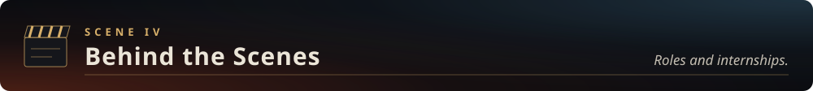

| Role | Where | When | The work |
|---|---|---|---|
| **Founding Department Secretary** | B.Sc. Data Science, Kumaraguru College | 2024 – 25 | Led department-wide initiatives and ran technical symposiums and workshops with faculty for 200+ students |
| **Level 1 Member** | iQube Innovation Center | 2024 – 25 | Built a proof of concept for automated threat detection |
| **Data Analytics Intern** | Mallow Technology, Karur | Jun 2024 | Built end-to-end data pipelines and interactive Power BI dashboards |
| **Project Intern** | TATA Groups, Coimbatore | Feb – May 2023 | Data analysis with SQL, Python and Excel for business intelligence |

 

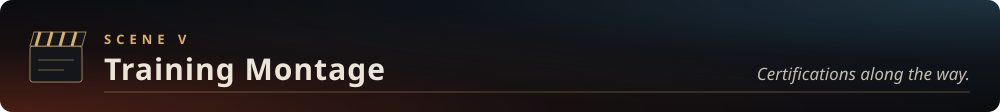

| Certification | Issued by |
|---|---|
| Red Hat System Administration I & II | Red Hat · Feb 2026 |
| OWASP Top 10: Web Application Security | Infosys · Feb 2026 |
| Next-Generation Agritech: AI & Predictive Analytics | IIT (BHU) & CHRIST · Mar 2026 |
| Oracle Cloud Infrastructure Architecture | Oracle · Nov 2025 |
| Python Programming for Everybody | IBM |
| Exploratory Data Analysis with Python & Pandas | Coursera |
| Processing Data with Python | Coursera |
| Database Management Essentials | Coursera |
| Digital Transformation & Business Intelligence | STAIR |
| Robotic Process Automation Foundation (Naan Mudhalvan) | UiPath |
| Data Analytics with Excel | 360DigiTMG |

 

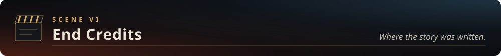

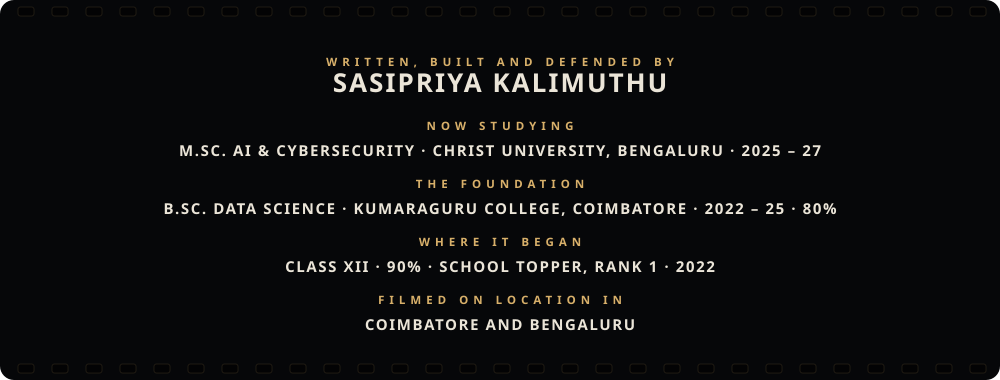

  &nbsp;
  &nbsp;
  

This page is the teaser. The full trailer is on my portfolio.

